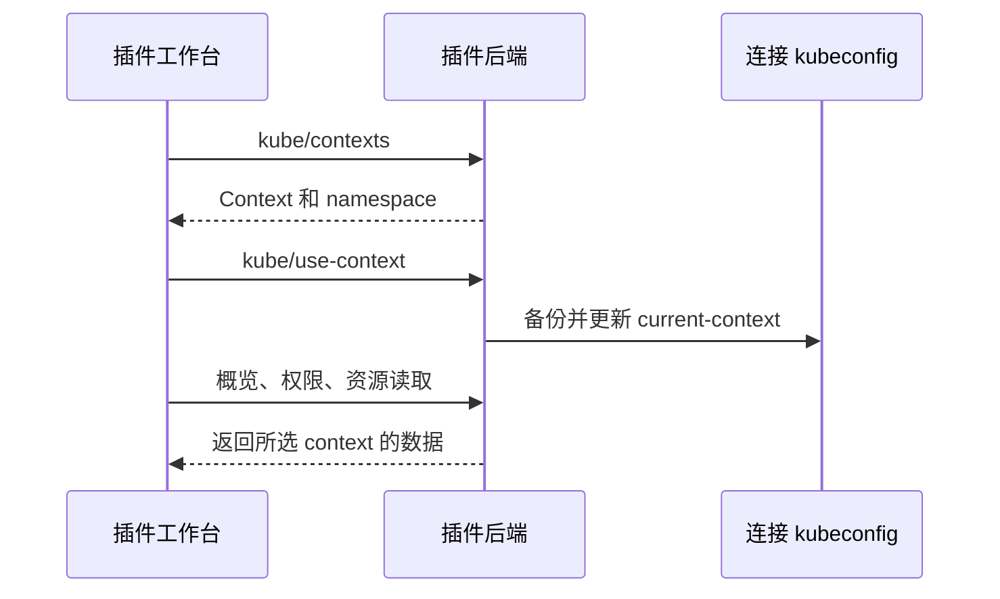
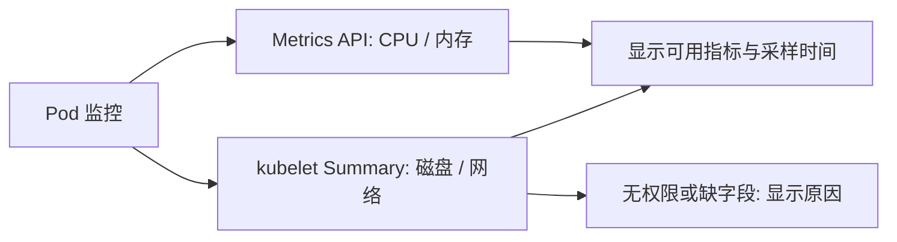

# 插件集成与交互

0.5.0 使用原版 DBX 的连接表单、工作台、invoke、事件、存储与文件传输能力。不修改宿主或 SDK。

kubeconfig 会话采用所选 context 的 namespace，未声明时为 default，旧连接级 namespace 仅对 Token 连接有效。即使没有枚举 namespace 的权限，工作台也保留当前 namespace 选项。context 写入串行执行，旧异步响应不能覆盖新选择。

## 资源只读

资源界面没有删除、扩缩容或重启控件，对应 JSON-RPC 方法返回 `-32013`，无需建立会话。HTTP 层只允许 GET，以及三个非持久化身份/权限 self-review POST；其它写入在发送前拒绝。MCP 工具只有资源列表、详情、Pod 日志。

本地终端按用户要求保留，执行用户手动命令，遵循 RBAC。配置导入和默认 context 切换会更新本地 kubeconfig。

## 界面

`ui/controls.js` 管理插件自有菜单和详情分隔条。菜单将原 select 作为隐藏模型，跟随选项、权限和选择变化；支持搜索、键盘、Escape 与外部点击关闭。详情宽度按可用视口限制，存储于插件 KV 的 `detail-width`，不依赖 DBX 的内部组件。

Pod 摘要优先展示 CrashLoopBackOff、镜像拉取错误、Init 错误及 Terminating 状态，分母取 spec.containers；重启数包含 init 容器。所属对象来自真实 controller ownerReference，不推测上游 Deployment。其它资源按其实际字段展示列；Node CPU/内存是 allocatable，不是实时用量。

## 导入与终端

选择或拖入 YAML 走同一合并逻辑，目标为连接的配置文件。同名条目覆盖，其余保留，写入前备份原字节，原子重命名，文件权限为 0600。`kube/contextsChanged` 事件刷新同文件的工作台。未知源目录时拒绝相对文件引用。

每个 context 的多个 xterm/PTY 标签独立保留，后台输出按 stream id 路由。PTY 使用 0700 临时目录中的 0600 配置快照，默认 context 固定；其它选择不会重定向它。重启/退出/关闭工作台/断开连接清理对应进程与快照。

## 监控与容器终端

Pod 列表一次请求 namespace 的 `PodMetricsList`，按 namespace/name 合并，旧列表响应通过版本号丢弃。详情监控串行轮询，不重叠；切换资源、标签、namespace、context 或关闭工作台后丢弃迟到响应。CPU 使用毫核，内存为 working set。资源预算区分未设置、显式 0 与部分无 Limit，包含 init/sidecar 的峰值及 Pod overhead，容器表展示各自的原配置。

Summary 只返回所选 Pod 的统计，匹配 namespace/name/UID，避免混入同名替换 Pod。网络按统计时间计算接收/发送累计字节的变化率，首次采样、计数重置及无效时间不生成 0。磁盘区分 ephemeral-storage 与挂载卷，不宣称提供磁盘 IOPS。API 失败时图表不把旧读数冒充实时数据。

容器终端与本地 shell 共用 PTY 生命周期。后端再次校验运行中的容器，Shell 仅允许 `/bin/sh`、`/bin/bash`，用参数数组启动 kubectl；不开放资源 HTTP 写入通道。容器终端由用户显式点击开启，监控不会自动 exec 命令。镜像没有 Shell 时保留 kubectl 的真实错误，可重新选择 Shell。

依据：[Metrics API](https://kubernetes.io/docs/tasks/debug/debug-cluster/resource-metrics-pipeline/) · [kubelet Summary](https://kubernetes.io/docs/reference/instrumentation/node-metrics/) · [统计字段](https://kubernetes.io/docs/reference/kubelet-api/stats.v1alpha1/) · [kubectl exec](https://kubernetes.io/docs/reference/kubectl/generated/kubectl_exec/)。
